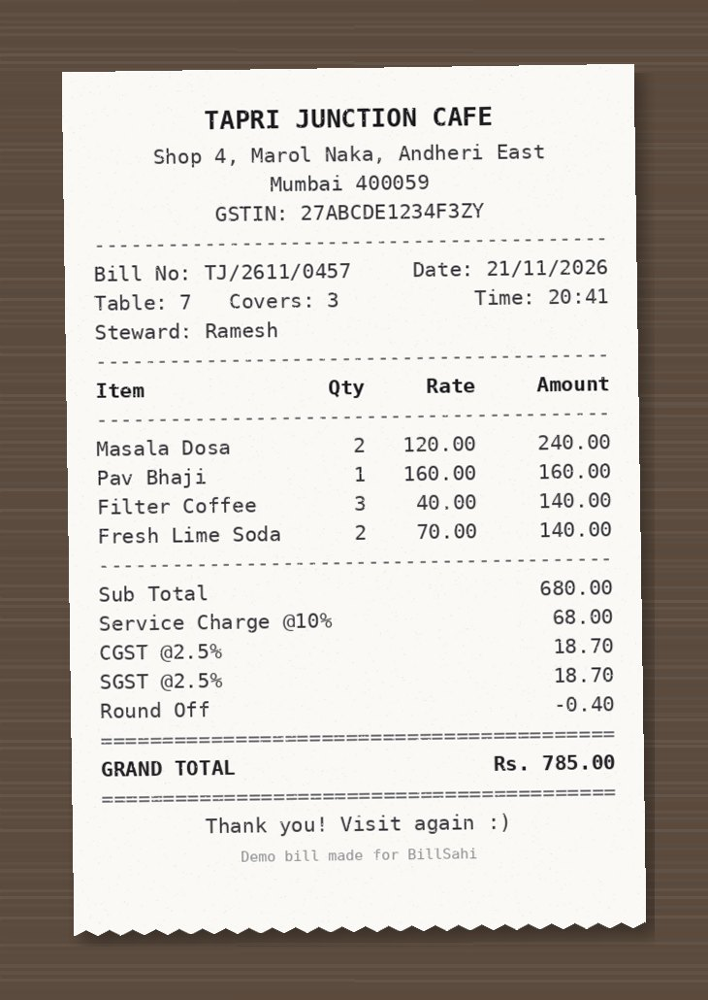

# BillSahi: is your bill sahi?

Snap a photo of any Indian bill (restaurant, medical store, kirana, electricity) and find out in seconds whether you were charged correctly.

**Live demo:** [billsahi.vercel.app](https://billsahi.vercel.app) · No bill handy? The home page has three demo bills with planted mistakes.

<p align="center"></p>

## The idea in one line

**AI reads. Code checks.**

| Step | Who does it | Why |
| --- | --- | --- |
| 1. Read the photo into structured JSON | Gemini (vision model) | Reading messy thermal receipts is what AI is genuinely good at |
| 2. Redo every calculation | Plain TypeScript (`src/lib/verify.ts`) | Arithmetic should never depend on a model's mood. Same bill, same verdict, every time |
| 3. Explain the verdict in English, Hindi or Marathi | Gemini (text) | Language is AI's strength, but it gets the verdict as fixed input and is told never to change a number |

The most important line in the whole project is the first rule of the reading prompt: **copy every number exactly as printed, never fix the math.** A model that "helpfully" corrects a wrong total hides the very overcharge BillSahi exists to catch.

## The 12 checks

1. Each line: quantity × rate = amount
2. No price above the printed MRP
3. Items add up to the subtotal
4. No repeated lines (possible double entry)
5. Charges match their printed %
6. Service charge flagged as optional (CCPA guidelines, upheld by the Delhi High Court in March 2025)
7. Tax amounts match their % (handles tax-inclusive bills like most pharmacies)
8. CGST equals SGST, and never IGST + CGST together
9. Grand total adds up
10. Round-off stays under ₹1
11. GSTIN passes the official Luhn mod-36 check digit, entirely offline
12. Bill date isn't in the future (usually a misread)

Every finding shows its working ("3 × ₹40 = ₹120, but the bill says ₹140") and how many rupees are at stake. If the AI misreads a number, the user can fix it on the digital receipt and the checks re-run instantly in the browser, with no AI call needed.

## Run it

```bash
pnpm install
cp .env.example .env.local   # add your free key from https://aistudio.google.com/apikey
pnpm dev                     # http://localhost:3000
pnpm test                    # verdict engine tests (no API key needed)
```

`/?sample=restaurant&saved=1` opens a demo bill's saved reading without calling the AI.

## Project map

```
src/lib/verify.ts      the verdict engine: 12 deterministic checks, runs on server and in browser
src/lib/gstin.ts       GSTIN format + check-digit validation
src/lib/schema.ts      zod schema that forgives messy AI output ("₹1,250.50" → 1250.5)
src/lib/gemini.ts      REST client with a model fallback chain and request-shape fallback
src/lib/prompts.ts     reading + explanation prompts
src/app/api/analyze    photo → AI reading → verdict
src/app/api/explain    verdict → plain-language explanation (verdict recomputed server-side)
src/components         UI: upload, rubber-stamp verdict, editable digital receipt
scripts/make_samples.py  generates the demo bills + their ground-truth JSON (also the test fixtures)
tests/verify.test.ts   14 tests: demo bills, edge cases, GSTIN vectors, messy-number parsing
```

## Design

Carbon-copy blue (the ink of old duplicate bill books), thermal-paper slips with torn edges, and the verdict as a rubber stamp in Devanagari: **सही है**, **ज़रा देखो** or **गड़बड़**. Type is Baloo 2 (Latin + Devanagari) with IBM Plex Mono for the receipt itself.

## Honest limits

- Photos are sent to Google Gemini to be read. BillSahi stores nothing, but on Gemini's free tier Google may use inputs to improve its products, so the app tells users to avoid bills with personal details.
- Bills with several GST rates and no printed taxable value skip the tax-% check rather than risk a false accusation.
- Handwritten and badly faded bills are read less reliably. Low-confidence lines are marked "unsure" so the user can fix them.
- Findings explain consumer rules in plain words. They aren't legal advice.

---

Built by Sanket Gupta in Mumbai.
